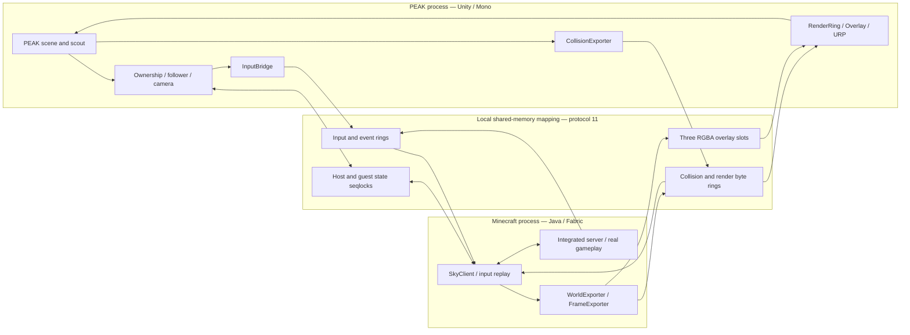
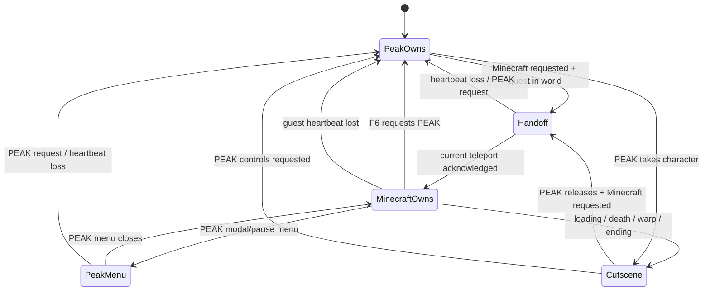
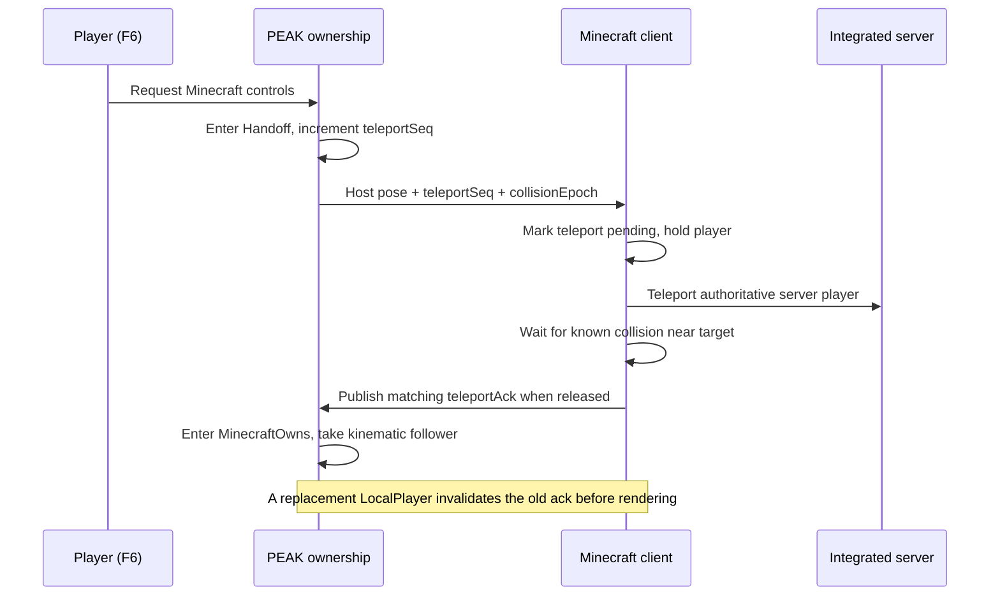

# MinePeak

**Run real Minecraft Java gameplay inside PEAK's world.** MinePeak links a PEAK BepInEx plugin to a separate Minecraft Fabric client and integrated server. Minecraft supplies player physics, inventory, crafting, blocks, entities, viewmodels and HUD; PEAK supplies its level, lighting, scenery, interactions and expedition progression.

This is a **Windows, solo-play prototype**, adapted from [PeakCraft](https://github.com/aeironnsarmiento/PeakCraft) and [SkyCraft](https://github.com/chasmlol/SkyCraft). It requires your own installations of both games. It does not redistribute either game or turn PEAK into a Minecraft executable.

**Players:** read [PLAY.md](PLAY.md) and launch **Play MinePeak.cmd** on the configured computer. **Developers:** the architecture, protocol, build, diagnostics and limitations are documented below. [VERIFICATION.md](docs/VERIFICATION.md) records what has actually been tested.

## Contents

- [Compatibility and current scope](#compatibility-and-current-scope)
- [Launching and controls](#launching-and-controls)
- [Architecture](#architecture)
- [Ownership and handoff](#ownership-and-handoff)
- [Coordinates and body synchronization](#coordinates-and-body-synchronization)
- [Shared-memory protocol](#shared-memory-protocol)
- [Collision export](#collision-export)
- [Rendering and HUD](#rendering-and-hud)
- [Input, hazards and respawn](#input-hazards-and-respawn)
- [Persistence and process lifecycle](#persistence-and-process-lifecycle)
- [Repository layout](#repository-layout)
- [Building and installation](#building-and-installation)
- [Configuration](#configuration)
- [Testing and diagnostics](#testing-and-diagnostics)
- [Performance and known limits](#performance-and-known-limits)
- [Upstream and licensing](#upstream-and-licensing)

## Compatibility and current scope

The local installation was built against these versions on **9 October 2026**. Compatibility with other PEAK or Minecraft versions is not implied.

| Component | Version / requirement |
|---|---|
| OS | Windows x64; Win32 shared memory and Java native access required |
| PEAK | 2.6.b, Steam app `3527290`, observed build `25739797` |
| PEAK engine/backend | Unity `6000.3.15f1`, Mono managed assemblies |
| BepInEx runtime | 5.4.23.3 in an isolated profile |
| PEAK bridge | `aeironnarmiento.PeakCraft.dll`, patched version 0.1.1 |
| Minecraft | Java Edition 26.3 |
| Fabric Loader | 0.19.5 |
| Fabric API | `0.161.0+26.3` |
| Fabric bridge artifact | `skycraft-0.1.2.jar`; original mod ID/version retained |
| Java runtime/compiler | Java 25; local Temurin directory `jdk-25.0.4.1+1` |
| .NET SDK | 10.0.401; plugin target `netstandard2.1` |
| Gradle / Loom | Wrapper 9.7.1 / pinned Fabric Loom 1.18.3 |
| Upstream source | PeakCraft revision `d07030ee527ee2a2facc989f5acae8a317968c02` |

The bridge is for PEAK's **Play Solo** mode. Placed Minecraft blocks are not synchronized through PEAK's multiplayer transport. The inherited Java source contains some Minecraft multiplayer code; that does not establish supported PEAK multiplayer behavior.

### Two control modes

| Mode | Movement and interaction | Visible world additions |
|---|---|---|
| PEAK | Original climbing, stamina, scout equipment, expedition items and ending | Original PEAK scenery; Minecraft block sections hidden |
| Minecraft | Minecraft movement, jumping, sneaking, flying in Creative, block placement, breaking and inventory | Minecraft meshes/entities/avatar and interface drawn in PEAK |

Press **F6** to switch after closing menus. Switch back to PEAK while standing on original PEAK ground: Minecraft blocks have no Unity colliders and cannot support PEAK's scout in PEAK mode.

PEAK's mountain is exported as collision geometry. It is **not a generated Minecraft landscape** and cannot be mined as ordinary Minecraft terrain. Actual Minecraft blocks that you place can be broken and used normally.

## Launching and controls

### On the configured computer

1. Close the running PEAK and Minecraft clients normally.
2. Run **Play MinePeak.cmd** from this repository folder.
3. In **Minecraft Launcher → Java Edition**, select **MinePeak** and click **Play**. If Launcher displays its standard modded-installation confirmation, finish that confirmation. A second click is needed there.
4. Select **Play Solo** in PEAK. Minecraft opens its mirror world and hides its own window after the link activates.
5. Use PEAK controls for boarding and the flight. After landing, press **F6** to enter Minecraft mode.

The launcher selects the isolated BepInEx preloader through Doorstop's `--doorstop-target-assembly` argument and starts PEAK at 1280×720 windowed. It copies the latest built bridge DLL and Fabric JAR from `dist/MinePeak` before starting. It refuses an update while `PEAK.exe` or `javaw.exe` is running; the Java check is deliberately conservative and can include another Java GUI application.

The local launcher paths are stored in ignored `.runtime/launch-paths.cmd`. The current repository is configured for this computer; a fresh clone still needs the games, BepInEx profile and Minecraft Launcher installation configured as described in [Building and installation](#building-and-installation).

### Default Minecraft-mode bindings

| Input | Action |
|---|---|
| F6 | Toggle PEAK/Minecraft ownership request |
| WASD, Space, Shift | Minecraft movement, jump, sneak |
| Left mouse | Attack / break Minecraft blocks |
| Right mouse | Place / use selected Minecraft item |
| 1–9, mouse wheel | Select Minecraft hotbar slot |
| E | Inventory / Creative inventory |
| T | Minecraft chat and commands |
| F5 | Cycle Minecraft camera views |
| G | Invoke PEAK's targeted interaction; hold when required |
| O | Open Minecraft pause menu |
| Esc | Close an open Minecraft screen, otherwise open PEAK pause menu |

The mirror world starts in Creative and includes a starter/builder kit. `/gamemode survival` enables Minecraft Survival after supplying resources; `/gamemode creative` restores Creative. Survival hazard/death integration remains an area for broader playtesting.

## Architecture

Two independently running engines communicate on the same PC. The bridge does not stream a video of Minecraft's terrain into PEAK: it transfers render geometry and an interface image, allowing PEAK to draw the added objects in its own scene.



### PEAK frame order

`Plugin` runs at Unity execution order **−1000**. Its update order is:

1. Publish heartbeat and process optional development commands.
2. Check Minecraft heartbeat/PID and read the guest state through a seqlock.
3. Drain guest events and read the mode-switch key.
4. Decide the ownership state.
5. Follow Minecraft's interpolated body when Minecraft owns it.
6. Export surrounding PEAK collision and pump input.
7. Bridge hazards/death and set PEAK HUD visibility.
8. Consume render messages and update overlay pixels as appropriate.
9. Publish the host pose, flags, viewport and teleport sequence.

The postfix on `MainCameraMovement.LateUpdate` places the camera after PEAK's own camera update, so PEAK interaction rays use the Minecraft view. `OnGUI` composites Minecraft's HUD/interface last, while keeping PEAK menus available.

### Minecraft frame and server order

`MinecraftMixin` calls `SkyClient.beginFrame()` at the start of `runTick`, exports guest state/geometry after `GameRenderer.render`, then paces against the host state sequence. Client ticks handle player parking and physics samples. `FrameExporter` asynchronously reads HUD/viewmodel pixels back from the GPU.

The integrated server remains Minecraft's authority for inventory, crafting, block updates, entities and damage. `PlayerHold` publishes an immutable, volatile, UUID-specific parking target across the client/server threads. Server-player tick hooks apply that target before and after both `tick` and `doTick`; server ticks are not cancelled.

## Ownership and handoff

Every PEAK patch consults the same `Ownership` instance. Switching a camera without switching physics, input and HUD together would leave two engines controlling the same player.



| State | PEAK input | PEAK camera/HUD | Minecraft follower | Overlay/blocks |
|---|---|---|---|---|
| `PeakOwns` | Original | Original | Released | Hidden |
| `Handoff` | Gameplay reset | PEAK camera/HUD | Released until acknowledgement | Hidden |
| `MinecraftOwns` | Replaced by bridge | Minecraft camera/HUD | Kinematic, original renderers hidden | Visible |
| `PeakMenu` | PEAK menu input | Minecraft camera, PEAK HUD/menu | Still follows Minecraft | PEAK menu takes visual priority |
| `Cutscene` | Gameplay reset | PEAK camera/HUD | Released | Render path remains active; menus can cover overlay |

`PeakMovement` allows PEAK's movement update in `Handoff`; input is reset, rather than cancelling PEAK's entire physics simulation. A handoff does not guarantee the scout is physically motionless in every external circumstance.

### Teleport acknowledgement



The guest reports an intentionally mismatching acknowledgement while a teleport is pending or the collision hold is active. A respawn can replace `LocalPlayer` after frame-start processing, so replacement detection also runs during client ticks and immediately before exporting rendered state. This prevents a fresh void-world spawn from being published as an already-acknowledged player pose.

PEAK airport deaths request a fresh teleport rather than killing the scout. Outside the airport, an active Minecraft death invokes PEAK's death flow. Death events from a parked guest are ignored while PEAK controls are requested.

## Coordinates and body synchronization

One Minecraft block corresponds to **one Unity world unit** in this adapter. `Coords` is the conversion boundary:

```text
mc.x     = unity.x
mc.y     = unity.y + YOffset          # default YOffset = -512
mc.z     = -unity.z
mc.yaw   = normalize(unityYaw + 180 degrees)
mc.pitch = -PEAK.lookValues.y

unity.x  = mc.x
unity.y  = mc.y - YOffset
unity.z  = -mc.z
```

The Z reflection also changes triangle winding. Block section meshes swap two triangle indices so their exterior faces remain outward-facing. The mirror dimension's build range is −1024 through 1023; the vertical offset places PEAK's usual terrain inside it. The Java constant `UNITS_PER_BLOCK = 70` is inherited Skyrim support, not PEAK's scale conversion.

The scout's nominal feet are its torso center minus **1.089 Unity units**. Minecraft supplies eye height and the previous/current 20 Hz physics samples. `Follower` uses Windows QueryPerformanceCounter timestamps to interpolate those samples on PEAK's frame clock; stale/teleporting sample pairs fall back to the reported pose.

### Ragdoll drift correction

The original follower moved only the root transform of PEAK's nested body hierarchy. Child rigidbodies can retain independent physics poses, causing the hidden torso to trail the Minecraft player despite a correct camera.

The patched follower:

1. Reads the torso's **Rigidbody position**, rather than assuming its visible transform is the latest physics pose.
2. Calculates the displacement to the interpolated Minecraft feet.
3. Snapshots **all** ragdoll rigidbody world positions before writing any body.
4. Applies that displacement to each saved physics position.

Snapshotting avoids applying displacement twice through parent/child movement. Releasing the follower restores kinematic state, original renderer visibility, velocities and item-selection flags. Release does not force an old Minecraft position over a PEAK warp or cutscene.

## Shared-memory protocol

The configured mapping is **`Local\MinePeak_v1`**. The protocol's inherited default remains `Local\SkyCraft_v1`; both games must explicitly use the same configured name. `Local\` scopes it to the Windows session.

The layout is fixed at **protocol 11**, defined in three places:

- [`protocol/skycraft_protocol.h`](vendor/PeakCraft/protocol/skycraft_protocol.h)
- [`peak/.../Link/Proto.cs`](vendor/PeakCraft/peak/src/PeakCraft/Link/Proto.cs)
- [`fabric/.../link/Proto.java`](vendor/PeakCraft/fabric/src/main/java/dev/skycraft/link/Proto.java)

There is no protocol-version bump in this patch. Parking and requested PEAK ownership use the existing host `Loading` flag.

| Region | Offset | Role |
|---|---:|---|
| Header | `0x00000000` | Magic `0x43594B53` (`SKYC`), version, process IDs, heartbeats |
| Host state | `0x00000100` | Flags, pose, viewport, world ID, collision epoch, teleport sequence |
| Guest state | `0x00000200` | Minecraft pose, flags, acknowledgement, camera/physics samples |
| Overlay control | `0x00000300` | Triple-buffer ownership/control |
| Overlay slot headers | `0x00000340` | Dimensions, flags, frame IDs |
| Water grid | `0x00000400` | Inherited shared water state |
| Input ring | `0x00001000` | 4096 input entries, host → guest |
| Actor table | `0x00012000` | Inherited actor/proxy table |
| Event ring | `0x00017000` | 512 guest events |
| World entities | `0x0001C000` | Entity state table |
| Collision ring | `0x00020000` | 32 MiB byte-ring region, host → guest |
| Overlay pixels | `0x02020000` | Three maximum-size RGBA slots |
| Render ring | `0x07F0C000` | 64 MiB byte-ring region, guest → host |
| Mapping end | `0x0BF0C000` | 200,327,168 bytes, approximately 191.05 MiB |

The mapping size is reserved shared address space, not a measurement of the total RAM consumed by either game. Overlay slots are sized for 3840×2160×4 bytes regardless of the current viewport.

### State and queue semantics

- State structs use **seqlocks**: odd sequence during writes, even after publication; torn reads retain the previous complete state.
- Rings are single-producer/single-consumer. Their head is at relative `0x00`, tail at `0x40`, data at `0x80`.
- Input entries encode SDL scancodes/buttons, scroll, cursor, Unicode text, release-all, damage and menu-open events.
- Collision/render byte messages carry a type and payload length. Unknown render types can be skipped by their length.
- PEAK's guest timeout is **3 seconds**. Java's host heartbeat timeout is **8 seconds**, tolerating longer host loading stalls.
- `GetTickCount64` drives heartbeats. `QueryPerformanceCounter` supplies a common interpolation clock across processes.
- A new guest PID resets PEAK's collision export and overlay state. Scene/segment changes increment `collisionEpoch` and clear the guest collision cache.

The local protocol is trusted-process IPC, not a hardened network serialization format or sandbox boundary. Both components use native memory access; keep the three layout definitions synchronized when changing structures.

## Collision export

PEAK's shipped collider meshes are not generally readable as raw vertex data. `CollisionExporter` samples the physics scene on a **0.5-unit horizontal grid**, using layers `Terrain`, `Map` and `Default`, while excluding trigger colliders.

For each column it finds solid top/underside spans and derives floor, ceiling and wall triangles between neighbouring samples. It also emits 1/8-block occupancy bits for placement/support, other entities and initial teleport readiness. The local Minecraft player uses the more accurate triangle collision path.

| Export parameter | Current value |
|---|---:|
| Region edge | 8 blocks |
| Horizontal samples per region | 17×17 vertices at 0.5 spacing |
| Maximum spans per sample | 8 |
| Scheduled horizontal radius | 3 regions; 7×7 region columns |
| Vertical window | 3 regions below + current + 2 above; 48 blocks |
| Adjacent-span join tolerance | 1.0 block |
| Nominal per-frame budget | 2.5 ms |
| Backlog threshold | 12 MiB |
| Near/far refresh periods | 6 / 45 seconds |
| Eviction distance | Beyond radius + 2 region columns |

An individual column is processed as one work unit, so the nominal budget can be exceeded by a costly column. This is a cooperative budget rather than a hard real-time limit.

During initial handoff, Minecraft requires known collision at the target cell, below it, and one region farther below. It releases after ground is known, or after **6 seconds** when those cells are known but no nearby support is found. The timeout does not bypass the requirement that collision cells be known. A small vertical lift can move a teleport out of sampled ground that slightly overlaps the requested feet.

The representation approximates PEAK geometry. Thin surfaces, complex props and rapidly changing scenery can differ from Unity's exact colliders. Minecraft block collision remains Minecraft's own collision and is not exported back into Unity.

## Rendering and HUD

`WorldExporter` sends Minecraft's actual block atlas, section meshes, texture updates, animated avatar, entity/particle batches and selection outline. `RenderRing` consumes up to **24 MiB per PEAK frame** and drains messages even when Minecraft additions are hidden, keeping the producer from filling the queue indefinitely.

Block sections are Unity meshes at their 16-block section coordinates. PEAK's shipped **URP particle shaders** provide vertex-color tinting, lighting, depth, shadows and fog. The default brightness multiplier is 0.6. Transparent/cutout surfaces are classified from texture alpha because the available PEAK shader variants do not supply all Minecraft material behavior.

First-person arms/items are part of the transparent Minecraft overlay; third-person avatar and scene geometry are drawn in Unity. PEAK mirror cameras can receive a standing-body fallback. The bridge follows the user's Minecraft skin; it does not force Steve or change the user's account skin.

`FrameExporter` uses three GPU staging buffers for asynchronous RGBA readback, then publishes the newest complete frame through the shared triple buffer. Unity uploads that image to a `Texture2D` with point filtering and composites it over the PEAK image. The HUD image contains hands, hotbar, inventory and Minecraft screens; normal Minecraft landscape rendering is replaced by PEAK's scene.

Maximum capture size is **3840×2160**. Captures above those dimensions are skipped. Start at 720p, especially while diagnosing performance.

## Input, hazards and respawn

### Input routing

`InputBridge` reads Unity's Input System devices and replays events through Minecraft's own handlers. PEAK owns the look angle for responsive camera movement. When a Minecraft screen opens, the bridge instead moves a virtual overlay cursor and forwards text/key repeat.

Gameplay routing requires `MinecraftOwns`, application focus, keyboard and mouse devices. Losing focus, entering a PEAK menu, changing ownership or losing the link sends **release-all**, clearing held keys/buttons. F6 is reserved by the host and is not replayed into Minecraft. Configuring the switch key as `None` safely disables polling.

During unload, the input text callback is detached, input is released, the PEAK HUD is restored and the shared mapping is closed.

### Hazards

While the follower is active, PEAK's affliction additions are intercepted. Injury, heat/cold, poison, thorns, spores and drowsiness accumulate into Minecraft damage; PEAK hunger/weight do not cross over. Damage is batched approximately every 0.5 seconds, with the configured `DamageScale` multiplier (default 3). Creative ordinarily ignores this damage.

Original PEAK statuses are cleared during Minecraft control. Switching modes is therefore not a simulation that preserves every stamina/affliction consequence identically across both games.

### Parking and respawn hardening

Client-only position resets did not stop the integrated server from simulating its player while PEAK owned the scout. The patch now parks the UUID-matching server player too, resets velocity/fall distance and ignores ordinary damage during the hold. Damage types marked `BYPASSES_INVULNERABILITY`, including explicit kill/void mechanisms, retain their special behavior.

Player replacement invalidates the old acknowledgement before exporting the replacement pose. Airport death forces a new host teleport sequence. Together with the ragdoll synchronization correction, this addresses the observed feedback loop in which an immediate Minecraft respawn sent PEAK to the mirror world's void spawn.

Minecraft's mirror server uses `keepInventory` and immediate respawn. Outside the airport, Minecraft death triggers PEAK's death flow; inside it, the scout stays alive and the guest is reattached after respawn. The complete expedition death/ending flow still needs broader validation than a single airport recovery test.

## Persistence and process lifecycle

The official Launcher profile is named **MinePeak**, with profile key `minepeak`, version `fabric-loader-0.19.5-26.3` and game directory `<repo>/.runtime/minecraft`. Its JVM arguments include:

```text
-Xmx3G -XX:+UseG1GC --enable-native-access=ALL-UNNAMED
-Dskycraft.link=Local\MinePeak_v1 -Dskycraft.discordAppId=0
```

Launcher handles the existing licensed account/session. MinePeak does not need to read account token files. The first setup backed up `launcher_profiles.json` before adding the new profile. The Fabric version metadata is public; the user's regular `.minecraft/mods` and saves are separate from MinePeak's game directory.

The persistent mirror world is:

```text
<repo>/.runtime/minecraft/saves/SkyCraft/
```

Buildings and inventory persist in that world across PEAK expeditions. There is no per-expedition or daily-map save namespace. Scene changes clear collision, but do not automatically discard existing Minecraft buildings. For a fresh mirror world, close both games and move its save directory to a safe backup location.

After PEAK closes, Java notices the host process has gone and saves/quits after a short grace period (approximately 5–6 seconds). `-Dskycraft.quitWithSkyrim=false` keeps the guest running during development. Normal launcher settings leave automatic quitting enabled.

The project and both bridge display names use **MinePeak**. **PeakCraft** names the upstream project credited in this repository. The inherited `PeakCraft` C# namespace/source directory, `aeironnarmiento.PeakCraft` assembly/plugin GUID/config filename, `skycraft` Fabric mod ID, `SkyCraft` save directory, and some protocol/log terms remain for compatibility. Renaming those identifiers would need a separate migration; they are not the current project's name. The inherited `Skyrim` and `quitWithSkyrim` terms do not mean Skyrim is required.

## Repository layout

```text
MinePeak/
├── README.md                       Technical reference
├── PLAY.md                         Player guide
├── Play MinePeak.cmd               Configured local launcher
├── UPSTREAM.md                     Source revision / attribution
├── scripts/
│   ├── SetupToolchain.ps1           Verified portable SDK setup
│   ├── toolchains.json             Publisher URLs / archive hashes
│   └── Build.ps1                   Build, test, package, optional install
├── docs/
│   ├── IMPLEMENTATION.md           Local implementation notes
│   └── VERIFICATION.md             Results and remaining acceptance checks
├── vendor/PeakCraft/
│   ├── peak/src/PeakCraft/          Unity/BepInEx C# component
│   ├── fabric/src/main/            Shared/server Java and datapack resources
│   ├── fabric/src/client/          Minecraft client Java component
│   ├── fabric/src/test/            Geometry and parking regression tests
│   ├── protocol/                   Original shared protocol header
│   ├── docs/                       Upstream design/research notes
│   └── tools/                      Upstream development utilities
├── .tools/                         SDKs / Gradle cache; ignored
├── .runtime/                       Profiles, logs, saves, backups; ignored
└── dist/MinePeak/                   Mod-only output / hashes; ignored
```

## Building and installation

### Portable toolchains

From the repository root in PowerShell:

```powershell
.\scripts\SetupToolchain.ps1
```

The setup downloads the pinned Windows x64 .NET and Temurin ZIPs from the publisher locations recorded in `scripts/toolchains.json`. It checks **SHA-512** for .NET and **SHA-256** for Java before extraction, and leaves machine PATH unchanged. Existing installed portable SDK directories are reused. The script is not a complete game/mod installer.

### PEAK references

The C# project references the user's PEAK managed assemblies and BepInEx core. Create the ignored `vendor/PeakCraft/peak/Config.Build.user.props` using the upstream template, for example:

```xml
<Project>
  <PropertyGroup>
    <PEAKGameRootDir>C:/Program Files (x86)/Steam/steamapps/common/PEAK/</PEAKGameRootDir>
    <PEAKBepInExDir>C:/path/to/MinePeak/.runtime/PEAK/BepInEx/</PEAKBepInExDir>
    <DeployModFiles>false</DeployModFiles>
    <RunThunderPipePackAfterBuild>false</RunThunderPipePackAfterBuild>
    <RunThunderPipePublishAfterBuild>false</RunThunderPipePublishAfterBuild>
  </PropertyGroup>
</Project>
```

Use your actual paths. PEAK must use its Mono build; this adapter references `Assembly-CSharp.dll` directly. Cpp2IL/Ghidra are not required to build this configuration.

### Build and package

```powershell
.\scripts\Build.ps1                 # build both components; run Java tests; package
.\scripts\Build.ps1 -Install        # also copy mods into existing local profiles
```

`-Install` requires both clients closed and checks again before copying. The script keeps Gradle's cache under `.tools/gradle`, uses the portable SDKs, and disables Thunderstore publishing/automatic game deployment targets.

Artifacts:

```text
vendor/PeakCraft/peak/artifacts/bin/PeakCraft/release/aeironnarmiento.PeakCraft.dll
vendor/PeakCraft/fabric/build/libs/skycraft-0.1.2.jar
dist/MinePeak/SHA256.json
```

The bundle contains the two mods, documentation, notices and binary hashes. It does not contain PEAK assemblies, BepInEx runtime, Fabric API, Minecraft libraries/assets, account data, SDKs or saves. Do not copy an assembly-publicizer's generated `Assembly-CSharp.dll` into a release.

### Configure a fresh local installation

1. Install a PEAK-compatible BepInEx 5 profile. Put the bridge DLL under that profile's `BepInEx/plugins`. Use a separate profile rather than mixing it with a large existing modpack.
2. Configure `[Link] MappingName = Local\MinePeak_v1` in `BepInEx/config/aeironnarmiento.PeakCraft.cfg`.
3. Install Fabric Loader 0.19.5 for Minecraft Java 26.3 through its supported installer/Launcher metadata route.
4. Create a separate Minecraft Launcher installation/game directory. Put `skycraft-0.1.2.jar` and the matching Fabric API JAR in its `mods` directory; select Java 25 and the JVM arguments shown above.
5. Configure `.runtime/launch-paths.cmd` with `MINEPEAK_STEAM` and `MINEPEAK_LAUNCHER`. The bundled play launcher expects the profile layout under `.runtime/PEAK` and `.runtime/minecraft`.
6. Match the shared mapping name and start both games under the same Windows user/session. Launch PEAK with the separate Doorstop preloader target.

Official references: [BepInEx Unity Mono installation](https://docs.bepinex.dev/articles/user_guide/installation/unity_mono.html), [Fabric installation](https://docs.fabricmc.net/players/installing-fabric), [Unity Rigidbody position API](https://docs.unity3d.com/6000.0/Documentation/ScriptReference/Rigidbody-position.html).

## Configuration

The PEAK configuration lives under the selected BepInEx profile, not necessarily the game's install directory:

```ini
[Link]
MappingName = Local\MinePeak_v1

[World]
YOffset = -512

[Keys]
PeakInteract = G
MinecraftMenu = O
ControlMode = F6

[Render]
BlockShader =
BlockBrightness = 0.6

[Hazards]
DamageScale = 3

[Dev]
Harness = false
```

Keep `YOffset` a multiple of 8 so collision regions align. Leave `BlockShader` empty to use the shader fallback search. Key values are Unity Input System `Key` names. Avoid assigning the same key to multiple bridge functions or Minecraft gameplay bindings.

`Harness = true` enables automatic solo startup and a local test-command file. Keep it disabled for normal play. The existing `config/skycraft.properties` Minecraft file includes an inherited `join=` option; leave it blank for the supported solo mirror world. Discord Rich Presence is disabled with `-Dskycraft.discordAppId=0`; the e4mc tunnel dependency was removed from this adaptation.

## Testing and diagnostics

### Automated tests

The Fabric Gradle build runs JUnit tests:

- **9 SkyRay tests:** nearest ray surface, face direction, surface placement/reach, projectile contact and misses.
- **12 TriCollider tests:** flat/sloped ground, walls, sliding, ceilings, jump arcs, falls and ledges.
- **4 PlayerHold tests:** UUID isolation, immutable snapshots, release, and rejection of invalid coordinates without corrupting the previous target.

Tests of queue layouts and ring wrap-around also run when the PEAK plugin starts. They do not substitute for live Unity physics, rendering or Minecraft Mixin validation.

### Development command interface

With `Harness = true`, write newline-separated commands to:

```text
<profile>/BepInEx/peakcraft-dev.txt
```

The harness polls roughly every 100 ms, consumes/deletes the file and logs results. The writer should wait until the previous file has been consumed before writing the next batch. These are direct mod test commands, not Windows keyboard automation.

| Command | Purpose |
|---|---|
| `where` | Scout/Minecraft feet, camera, ownership, kinematic state, stamina and ground |
| `assertstate MinecraftOwns` | Assert the current ownership state |
| `assertpose 0.05` | Assert physical and visible torso feet match the follower within 5 cm |
| `mode` | Request the same mode toggle as F6 |
| `key <SDL scancode> <0/1>` | Replay a Minecraft key |
| `mouse <SDL button> <0/1>` | Replay a mouse button |
| `text <text>` | Send text to an open Minecraft screen |
| `cursor <x> <y>` / `scroll <notches>` | Overlay input |
| `releaseall` | Clear held guest input |
| `look <yaw> <pitch>` | Set host look angle |
| `pause` / `closewindows` | PEAK menu checks |
| `tp <x> <feet-y> <z>` | PEAK warp in Unity coordinates |
| `teleport` | Increment the guest teleport request |
| `board` / `endreturn` | Expedition lifecycle checks |
| `shot <name>` | Unity screenshot under `BepInEx/peakcraft-shots` |
| `res <width> <height>` | Resolution change |
| `quit` | Graceful PEAK exit |

`assertpose` requires a Minecraft-owned character. Check it while stationary first; a moving body/camera introduces frame/tick phase differences. The harness logs assertion exceptions, so a test runner must inspect the log for failures.

### Logs

```text
.runtime/PEAK/BepInEx/LogOutput.log
.runtime/minecraft/logs/latest.log
.runtime/minecraft/crash-reports/
vendor/PeakCraft/fabric/build/test-results/test/
```

Look for `protocol layout self-check: PASS`, `ring self-test: PASS`, all five `patch ok` lines, `link up`, and matching `ack current/requested` numbers after handoff. Guest log messages still say “Skyrim” for the inherited protocol host. Runtime frame-rate logging now uses unscaled time, so opening PEAK's pause menu does not falsely report 10,000 FPS.

See [VERIFICATION.md](docs/VERIFICATION.md) for live test outcomes and pending expedition checks. A successful build alone is not evidence that a new Mixin or native physics change works in-game.

### Troubleshooting

| Symptom | Check / recovery |
|---|---|
| MinePeak installation missing | Java Edition → Installations → Modded filter; restart Launcher after profile creation |
| Play appears to do nothing | Finish the modded-installation confirmation; inspect the Minecraft log timestamp |
| No MinePeak status in PEAK | Restart using the separate preloader; a running ordinary PEAK process cannot acquire the plugin |
| Waiting for Minecraft | Correct profile/game directory, equal mapping names, same user/session, guest log |
| Handoff persists | Collision export and epoch, current ack, game loading/cutscene state, guest exceptions |
| F6 ignored | Close Minecraft and PEAK screens; wait for loading; inspect `ControlMode` |
| Wrong scout location on switch | Confirm plugin 0.1.1 and both current binaries; run stationary `assertpose` |
| Falling/death loop after respawn | Check the patched guest acknowledgement and fresh airport teleport; inspect guest death/teleport logs |
| Severe stutter | Return to 720p; reduce entities/building load; inspect collision rays, backlog and exporter errors |
| Windows blocks development OpenGL DLL | The official Launcher profile started successfully; the Gradle dev launch was blocked. The security policy was not changed |

## Performance and known limits

Two game runtimes, a shared mapping, two graphics contexts and multiple image copies are active. Performance depends on viewport, scene collision complexity and Minecraft entity/block load.

Raw RGBA traffic per transferred image is `width × height × 4` bytes. At 60 complete frames/s, before staging/upload overhead:

| Viewport | Bytes per frame | Raw image traffic |
|---|---:|---:|
| 1280×720 | 3,686,400 | ~211 MiB/s |
| 1920×1080 | 8,294,400 | ~475 MiB/s |
| 3840×2160 | 33,177,600 | ~1,898 MiB/s |

These are calculated throughput estimates, not measured benchmark results. The GPU readback, shared-memory copy and Unity upload each add work. Minecraft's actual completed overlay frame rate may be lower than PEAK's frame rate.

Current limits:

- Solo support only; no PEAK peer replication for Minecraft buildings/entities.
- Minecraft blocks have no Unity colliders; they hide in PEAK mode.
- No conversion of PEAK scenery into mineable Minecraft resources or terrain generation.
- Collision sampling is approximate and may exceed its nominal frame budget on a complex column.
- Minecraft buildings persist across different PEAK maps; world identity uses the active scene/build index rather than an expedition seed.
- Normal PEAK stamina/afflictions and Minecraft Survival do not form one fully equivalent damage/resource model.
- Shader/material fidelity is approximate; some lighting, transparency, mirrors and effects differ from Minecraft.
- The local protocol is Windows-specific and assumes cooperating trusted processes.
- A full mountain completion, all hazard types, large TNT/water builds and multiplayer are not established by the automated geometry tests.

## Upstream and licensing

The upstream MIT licences and third-party notices are preserved under `vendor/PeakCraft`. [UPSTREAM.md](UPSTREAM.md) records source URLs and the pinned revision. This patch keeps the inherited namespace, plugin GUID and Fabric mod ID to preserve existing config/save compatibility.

Source control excludes local profiles, authentication material, saves, downloaded toolchains, game assemblies, caches and build output. Documentation diagrams are authored for this repository. Any gameplay screenshot included in documentation is an illustration from the user's installed games, not a bundled game asset.
